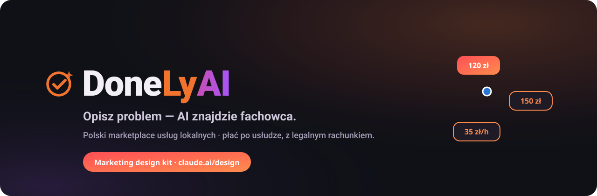

  

<h1 align="center">DoneLy&nbsp;AI — Design Kit</h1>

  <b>Marketing &amp; brand design source for DoneLy AI</b> — a Polish local-services marketplace. 
  Single <a href="https://claude.ai/design">claude.ai/design</a> canvas file. Import it, then generate banners, ads &amp; social assets.

  
  
  

---

## What is DoneLy AI

A Bolt/Uber-style marketplace for local pros (hydraulik, sprzątanie, opieka, detailing, artyści…). You **describe the problem, AI matches a verified pro** near you, **pay after the job** — the money stays frozen in escrow until you confirm, then DoneLy releases it and issues the legal rachunek/faktura (tax withheld). Pros earn legally without running a company.

## What's in this repo

| File | What |
|---|---|
| [`donelyai-banners.dc.html`](donelyai-banners.dc.html) | The design source — a claude.ai/design **canvas** with the full marketing banner set |
| [`hero.svg`](hero.svg) | The banner shown above (brand wordmark + tokens) |

### Banner set inside the canvas

- **Web ad set (IAB):** Leaderboard 728×90 · Medium Rectangle 300×250 (AI search) · Wide Skyscraper 160×600 · 2× Mobile leaderboard 320×50 · Square 250×250 (escrow)
- **Hero** 1920×600 — headline + map motif with price pins
- **Story** 1080×1920 — AI search + map, phone mock
- **App Store feature** 1024×500 — customer + pro variants

Every artboard carries the DoneLy AI wordmark, the `donelyai.app` CTA, and PL copy. Photo areas are stripe placeholders — swap for real imagery.

## Use it

1. Open [claude.ai/design](https://claude.ai/design).
2. Import **`donelyai-banners.dc.html`** (it's a native design-canvas file).
3. Resize / restyle / export individual banners, or ask Claude to generate new sizes from the same brand.

## Brand tokens

The whole palette lives in **5 CSS rules** at the top of the `.dc.html` `<style>` block — edit those to re-skin everything.

| Token | Value | Use |
|---|---|---|
| Accent | `#f2732e` | primary orange |
| Accent (dark) | `#ff8c4d` | orange on dark surfaces |
| Page | `#0f1117` | dark background |
| Surface | `#1e1a26` | cards |
| Ink | `#f3eff7` | text on dark |
| CTA gradient | `linear-gradient(160deg,#ff4f56,#ff8c4d)` | buttons / hero fill |
| "AI" gradient | `linear-gradient(90deg,#ff9a3c,#f2732e,#d24d9e,#a855f7)` | the wordmark's **AI** |

Wordmark: **Done** in ink/white · **Ly** in accent orange · **AI** in the orange→purple gradient. No `.app` suffix, no underline.

---

Design source only — the product apps live in their own repositories. Copy is Polish (PL); tone: friendly &amp; trustworthy.

